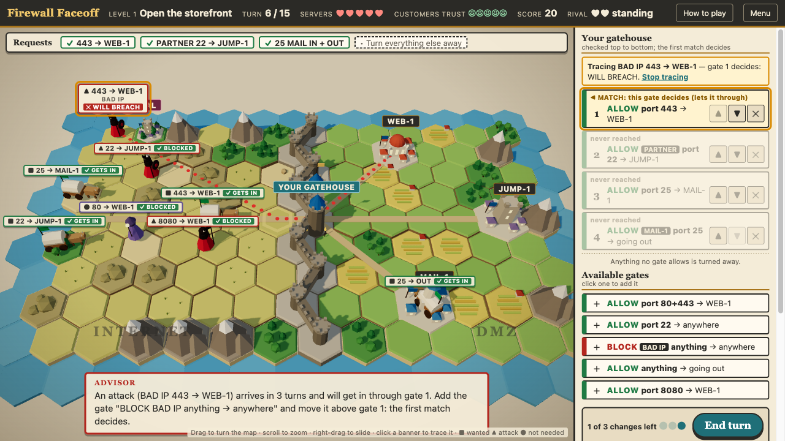

# Firewall Security Faceoff

**A turn-based strategy game about firewall rules. Your network is a city on a hex map, your firewall is its gatehouse, and every rule is a gate. Let the right traffic in, turn the rest away, and outlast the rival.**



Firewall Security Faceoff is for network engineers and students. Traffic marches across a 3D hex map toward your gatehouse: wagons are wanted traffic, raiders are attacks, drifters are traffic nobody asked for. Every unit carries a banner saying what it is and what your gates, as they stand right now, will do with it. Each turn you make up to three changes to your gates, then end the turn and everything moves one step. Gates are checked from the top down, the first match decides, and anything no gate allows is turned away. The firewall is vendor-neutral.

| Level | What you defend | What it teaches |
| --- | --- | --- |
| 1. Open the storefront | A web, mail and jump server facing the Internet | First match wins, implicit deny, least privilege, why a blocklist gate must sit above the gate it guards |
| 2. Let staff browse safely | An office going out to the Internet | Application gates instead of port gates, SCAN, why SCAN needs DECRYPT for encrypted traffic, DNS FILTER |
| 3. Clean up the data center | A database and an application server | Gates that name who is allowed, stopping a break-in from spreading, scanning traffic you trust |

**It explains itself.** There is a home menu, a How to Play screen, a briefing before each level, and a guided first level that walks you through the first turns and cannot be lost. An advisor line always says what needs fixing, and spare gates that would help are marked TRY.

**Controls.** Everything is a button: click a spare gate to add it, use ▲ ▼ ✕ on a gate to move or remove it, click a switch to flip it, press End turn. Drag the map to turn it and scroll to zoom. It all works from the keyboard with Tab and Enter.

**Three versions of the same lessons, one rule engine.** `index.html` is the strategy game above. `arcade.html` is a real-time 2D arcade version. `classic.html` is text only, with no motion, both difficulty tiers, and full written explanations.

A project from **NAF AC6 — Loop Engineering, Spec-Driven Development & the Future of VibeOps**.

| Project | Details |
| --- | --- |
| Status | All three levels playable in all three versions. 174 automated checks pass; browser checks are recorded in [docs/verification.md](docs/verification.md), including what was not verified |
| Networking topic | Next-generation firewall policy: rule order, least privilege, application and user identity, inspection, TLS decryption, DNS filtering, segmentation |
| Typical session | 15 to 18 turns per level (not yet timed with a first-time player) |
| Live demo | Not published |
| Built by | GTalksTech |

## Play locally

There is nothing to install. From the repository root:

```sh
python3 -m http.server 8000 --bind 127.0.0.1
```

On Windows with the Python launcher:

```powershell
py -m http.server 8000 --bind 127.0.0.1
```

Open **http://127.0.0.1:8000** in a current desktop browser. Keep the terminal running; **Ctrl+C** stops the server. If port 8000 is busy, use 8001 in both the command and the URL. Opening `index.html` directly with `file://` is not supported, because the game loads its modules and level data over HTTP.

## How it works

- **Every verdict comes from one rule engine** (`engine/rules.js`). The banners, the advisor and the end-of-turn results all ask it; nothing else decides whether traffic gets in.
- **The traffic is a fixed timetable** built from the level data. Units take three turns to reach the gatehouse, each attack appears twice, and new requests arrive mid-level. The same play always meets the same traffic.
- **Losing:** each attack that gets in costs a heart, each piece of wanted traffic turned away costs trust; run out of either and the level restarts. **Stars:** three for a level with nothing wrongly let in or turned away and a final gatehouse the engine agrees is correct.
- **The 3D map uses three.js**, copied into `vendor/` with its license. The 22 models in `assets/models/` were built in Blender by a script in this repository (`tools/blender/build_models.py`); none came from an asset pack. Nothing is downloaded when you play, and there is nothing to install to play.
- **Music and sound are made in the browser; there are no audio files.** The score is written out as notes in `strategy/score.js` (D minor, 16 bars) and played by `strategy/music.js` on plucked, flute, string, bass and drum voices built from oscillators. It is quieter on menus and adds drums and a low pulse while something bad is on its way to your gatehouse. Music and sound effects each have a switch on the home menu.
- **No text entry anywhere.**

## What the game simplifies

Each briefing states the simplifications that matter for that level. The main ones:

- The game models a firewall that checks rules in order and stops at the first match. NIST SP 800-41 notes that many firewalls work this way and others do not.
- A control that the sources say "can mitigate" an attack always stops it here.
- The firewall identifies every application and user correctly and immediately.
- Addresses match exactly; there is no subnet matching.
- Not modeled: address translation, routing, VPN, high availability, IPv6, logging, URL filtering, DNS over HTTPS, and decryption exemptions.
- Attacks are named techniques evaluated against the model. The game sends no network traffic and contains no exploit code.

Sources are listed in each briefing and in `data/levels.json`: NIST SP 800-41 Rev. 1, NIST SP 800-207, and MITRE ATT&CK technique and mitigation pages.

## Run the checks

Command line (needs Node 20 or later; used for tests only, not to play):

```sh
node tests/run-node.mjs
```

In the browser, with the server above running, open **http://127.0.0.1:8000/tests/**.

Both run the same 174 checks: the 33 hand-worked rule-base cases from the specification, content validation, session behavior, the arcade timetable, labels, hints and star rules, the strategy game's turn rules, and the music's written score. Expected results in `tests/cases.js` are copied from the specification and are never computed by the engine under test.

## Project layout

```text
index.html                       Strategy game shell
strategy/main.js, strategy.css   Strategy game: screens, gatehouse panel, advisor, guide
strategy/board.js                The 3D hex map (draws only; decides nothing)
strategy/turns.js                Turn timetable and turn rules (no screen; tested)
strategy/score.js, music.js      The music: the notes (tested), and the synthesizer that plays them
vendor/                          three.js, its glTF loader, and its license
assets/models/                   The 3D models (.glb), built by the script below
tools/blender/build_models.py    Rebuilds every model: blender --background --python tools/blender/build_models.py
arcade.html, game/               Real-time arcade version; game/logic.js is shared and tested
classic.html, style.css, main.js, ui/   Text version
engine/rules.js                  Pure rule evaluation, outcome, and score
engine/content.js                Validates the level data before play
engine/state.js, feedback.js     Text version session state and explanations
data/levels.json                 All level content, rivals, hints, sources, briefings
tests/                           Test harness, cases, and both runners
docs/verification.md             What was checked, and what was not
specs/                           Specifications, plan, and tasks
```

To add or change a level, edit `data/levels.json` and add its hand-worked cases to `tests/cases.js`. No engine or interface code changes. Adding `?speed=4` to the arcade version's address runs its clock faster; it is a testing aid.

## Known limits

- No person has play-tested the strategy game yet. It was driven by an automated browser, which shows it works and can be won, not that it is fun or well paced.
- Made for a desktop or laptop screen. On a phone the map is too small to be useful.
- The 3D models were built by a script driving Blender, not sculpted by an artist. They have bevels and smooth shading but no textures.
- Needs a browser with WebGL; if it is missing, the game offers the other two versions.
- Tested in one browser engine (Chromium). Not tested with a screen reader or touch.
- Nobody has listened to the music or the sound effects. The notes are checked to be in key and in time and the output is checked not to be silent or distorted, but whether it sounds good is unknown.
- The turn-by-turn battle mode from the original idea is not built.
- See [docs/verification.md](docs/verification.md) for the full list of checks that were not run.

## License

See [LICENSE](LICENSE).
